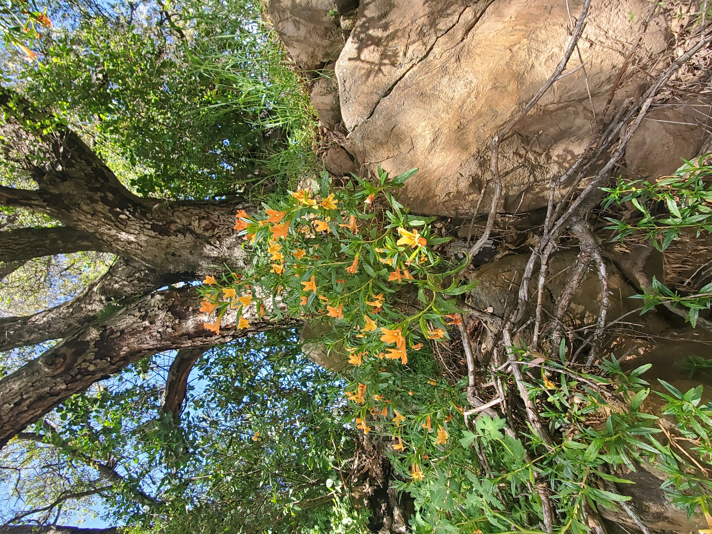

## Research

::: column-margin

:::

If we recognize speciation as the process of evolving reproductive isolation (i.e. reducing gene flow) between populations, we can broadly classify isolating mechanisms into two broad categories: 1) those that prevent gametes from coming together, and 2) those that decrease fitness of resulting hybrids if the first fails. My research has focused on the consequences of hybridization. Specifically, I have focused on seedling traits of *Mimulus aurantiacus* hybrids (see image).

## Talks

### Society for the Study of Evolution GREG Seminar



### Society for the Study of Evolution: Hamilton Award Talks


